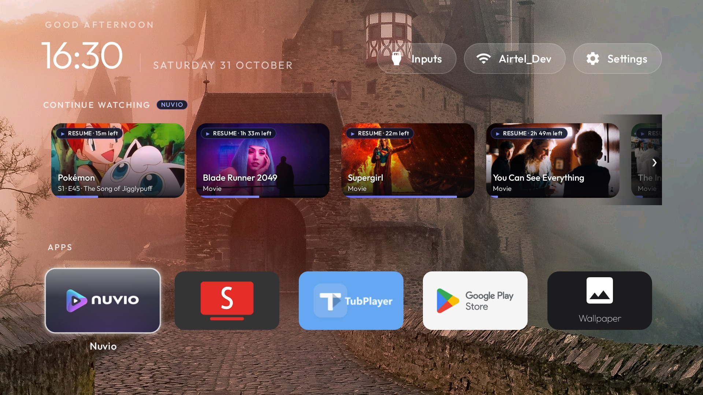

# TCL T6D (4K Google TV 14, G14 Platform)



- **Device:** TCL T6D (`Smart TV`, product `G14_4K_GB`, board `G14`)
- **Android Version:** Android 14 (SDK 34)
- **Firmware:** `G14-user 14 UTT2.250416.001 AU03 release-keys`
- **Launcher:** Custom `com.sdevs.tvhome` (Apple TV tvOS style, 8-column layout, Continue Watching shelf for Nuvio & Stremio, 31 4K rotating wallpapers, button remapping)
- **Kept Apps:** Nuvio (`com.nuvio.tv`), SmartTube (`org.smarttube.stable`), TubPlayer (`com.tubs.tubplayer`), Google Play Store (`com.android.vending`)

---

## What was done

1. **Full Pre-change Backup**: Packages, getprop, system/secure/global settings saved in `backup/tcl-t6d/`.
2. **Debloated 30 bloat, ad, and telemetry packages**:
   - Disabled TCL tracking and telemetry (`com.tcl.logkit`).
   - Disabled content promo and FAST channels (`com.tcl.waterfall.overseas`, `com.tcl.channelplus`, `com.tcl.partnercustomizer`, `com.tcl.interactive`, `com.tcl.messagebox`, `com.tcl.t_solo`).
   - Disabled retail demo mode and junk apps (`com.tcl.exhibit`, `com.tcl.esticker`, `com.tcl.hotelmenu`, `com.tcl.useragreement`, `com.tcl.usercenter`, `com.tcl.ocean.instructions`, `com.tcl.repairguide`, `com.tcl.hearaid`, `com.tcl.guard`, `com.tcl.magiconnectfree`).
   - Disabled unneeded streaming apps per user preference (`com.netflix.ninja`, `com.netflix.tokenmanager`, `com.amazon.amazonvideo.livingroom`, `com.google.android.youtube.tv`, `com.yablio.sendfilestotv`).
   - Disabled unused Google and stock media bloat (`com.google.android.feedback`, `com.google.android.marvin.talkback`, `com.google.android.play.games`, `com.google.android.youtube.tvmusic`, `com.tcl.ui_mediaCenter`, `com.google.android.apps.tv.dreamx`).
   - Disabled stock launcher and setup wizard (`com.google.android.apps.tv.launcherx`, `com.google.android.tungsten.setupwraith`).
3. **Preserved Critical Features**:
   - Google Assistant & Remote Mic Bridge (`com.google.android.katniss`, `com.google.android.tv.remote.service`).
   - Chromecast & Miracast (`com.google.android.apps.mediashell`, `com.tcl.miracast`).
   - AirPlay 2 (`com.tcl.airplay2`, `com.realtek.airplay2`).
   - TCL System Updates (`com.tcl.ttvs`).
   - TV Input Framework, HDMI & Live TV (`com.tcl.tv`, `com.tcl.tvinput`, `com.tcl.suspension`).
   - Play Store app auto-discovery (`com.android.vending`).
4. **Ad-Blocking Private DNS**:
   - Configured `dns.adguard-dns.com` system-wide.
5. **Installed heysachin Custom Launcher (`com.sdevs.tvhome`)**:
   - Built and installed `com.sdevs.tvhome` (355 KB, targetSdk 34).
   - 31 curated 4K wallpapers uploaded to `/sdcard/Wallpapers` with 30-minute auto-rotation and dim-veil Clock screensaver.
   - Android 14 Scoped Storage support via `MANAGE_EXTERNAL_STORAGE` and app-specific storage fallback (`WallpaperFolder.java`).
   - Live Continue Watching top shelf integrating directly with Leanback TvProvider and Nuvio.
   - Hidden system tiles (`hidden_apps` in `config.xml` for Health Connect, Quick Panel, Screen Mirroring, and Settings).
   - Remote button remapping via `HomeKeyService` (Netflix ➔ SmartTube, Prime ➔ Nuvio).

---

## Reversible & Restore

To restore all debloated packages at any time:
```bash
bash backup/tcl-t6d/restore.sh
```
Or to revert Private DNS:
```bash
adb shell settings put global private_dns_mode opportunistic
```
